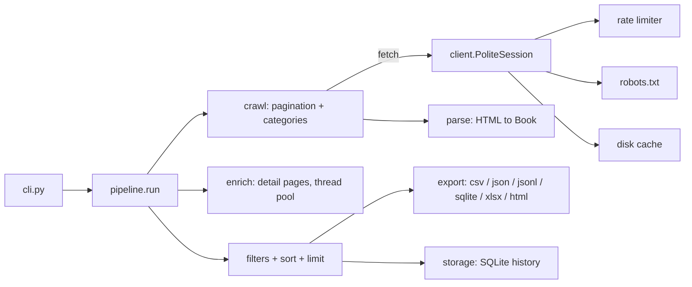

# Web Scraper

[](https://github.com/shifafaheem05-lgtm/web-scraper/actions/workflows/ci.yml)


A polite, fast and well-tested Python web scraper that collects book data from [books.toscrape.com](https://books.toscrape.com/) (a site built for practising scraping). It crawls the catalogue, visits every book's own page, filters and sorts the results, and exports them to **CSV, JSON, JSON Lines, SQLite, Excel or a self-contained HTML report** – and it can remember every run so you can see **price and stock changes over time**.

It is usable as a **command-line tool** and as a **Python library**.

## Features

**Scraping**
- **Multi-page crawling** – follows "next" links, with a page limit (`--max-pages`) or `--all-pages`.
- **Category scraping** – `--category Mystery`, several categories, or `--all-categories`. Typos get suggestions ("Did you mean: Mystery?").
- **Detail pages** (`--details`) – category, UPC, description, stock count, review count, product type, price excl./incl. tax.
- **Concurrent detail fetching** (`--workers`) – results stay in order, one broken page never aborts the run.
- **On-disk cache** – re-runs and crashed runs don't re-download pages (`--no-cache`, `--cache-ttl`, `--clear-cache`).

**Politeness (built in, not optional extras)**
- Identifies itself with a descriptive `User-Agent`.
- A **thread-safe rate limiter**: even with many workers it never exceeds one request per `--delay`.
- Respects **`robots.txt`**, including `Crawl-delay`; if robots.txt can't be read it errs on the safe side.
- Automatic retries with back-off on 429/5xx (and honours `Retry-After`).

**Data**
- **Filters** – min/max rating, min/max price, in-stock only, text search (title, plus description and category when scraped).
- **Sorting and limits** – `--sort price --desc --limit 10`.
- **Statistics** – count, average/median price, cheapest/most expensive, rating spread, price histogram, per-category averages.
- **Export** – CSV, JSON, JSONL, SQLite, XLSX, HTML. Pass `-o` several times to write several formats in one run; the format comes from the file extension.
- **HTML report** – a single offline file with charts, search box and sortable table (light/dark mode).
- **Price history** (`--db`) – SQLite store that reports new books, price changes and stock changes between runs.
- **Config file** – keep your favourite options in a TOML file (`--config`).

**Quality**
- Robust parsing: malformed cards are skipped with a warning, a looping "next" link can't cause an endless crawl, and a clear error appears if the layout changes.
- Fixes the classic encoding bug (`£51.77`, not `£51.77`).
- `Ctrl+C` stops cleanly and **saves the partial results**.
- Safe exports: spreadsheet formula injection is neutralised, and the HTML report escapes all scraped text and blocks `javascript:` links.
- **104 automated tests** (97% coverage) – unit tests plus integration tests against a local fake copy of the site, so they need no internet. Type-checked with `mypy --strict`, linted with `ruff`, CI on Linux and Windows for Python 3.9–3.13.

## Install

```bash
git clone https://github.com/shifafaheem05-lgtm/web-scraper.git
cd web-scraper

python -m venv venv
venv\Scripts\activate          # Windows
# source venv/bin/activate     # macOS / Linux

pip install -e ".[excel]"      # ".[dev]" adds the test and lint tools
```

This installs the `webscraper` command (`python -m webscraper` works too).

Or with Docker:

```bash
docker build -t webscraper .
docker run --rm -v "$PWD/output:/data/output" webscraper scrape --max-pages 2 -o output/books.csv
```

## Usage

```bash
# Quick start: first 3 pages -> output/books.csv
webscraper scrape

# Everything about the 4+ star books under £30, best value first, as CSV and a report
webscraper scrape --all-pages --details --min-rating 4 --max-price 30 \
    --sort price -o output/books.csv -o output/report.html

# One category, full details, Excel
webscraper scrape --category Mystery --all-pages --details -o output/mystery.xlsx

# What categories exist?
webscraper categories

# Track prices between runs (run it again tomorrow to see the changes)
webscraper scrape --all-pages --db output/history.db
webscraper history --db output/history.db "light in the attic"

# Summarise a file you already exported
webscraper stats output/books.csv

# Use a config file (command-line options override it)
webscraper scrape --config examples/webscraper.toml
```

### Options for `scrape`

| Option | Meaning | Default |
|---|---|---|
| `--max-pages N` / `--all-pages` | Pages per start URL (the site has 50) | 3 |
| `--category NAME` (repeatable) / `--all-categories` | Scrape categories instead of the whole catalogue | – |
| `--details` | Visit each book's page for extra fields | off |
| `--workers N` | Parallel workers for `--details` | 4 |
| `--min-rating` / `--max-rating` | Star range, 0–5 | 0 / 5 |
| `--min-price` / `--max-price` | Price range | none |
| `--in-stock` | Only books in stock | off |
| `--search TEXT` | Text in title (and description/category) | none |
| `--sort KEY` / `--desc` | Sort by `title`, `price`, `rating`, `stock`, `reviews` | none |
| `--limit N` | Keep the first N results | none |
| `-o, --output FILE` | Output file, repeatable. Formats: csv, json, jsonl, sqlite, xlsx, html | `output/books.csv` |
| `--format FMT` | Force a format instead of using the extension | from extension |
| `--db FILE` | Record the run and report changes since the last one | off |
| `--config FILE` | TOML file with default options | – |
| `--delay S` | Minimum seconds between requests | 1.0 |
| `--timeout S` / `--retries N` | Request timeout / retries on temporary errors | 15 / 3 |
| `--user-agent` / `--proxy` | Custom User-Agent / proxy URL | built in / none |
| `--no-cache` / `--cache-dir` / `--cache-ttl H` / `--clear-cache` | Cache control | on, `.webscraper_cache`, 24 h |
| `--ignore-robots` | Skip robots.txt (not recommended) | off |
| `-v` / `-q` | Debug / quiet output | – |

Run `webscraper scrape --help` for the full list. Exit codes: `0` success, `1` error, `2` bad arguments, `130` interrupted (partial results saved).

Example output:

```
Page 1: 20 books  (https://books.toscrape.com/catalogue/page-1.html)
Details: 20/20

Scraped 20 books, kept 7 after filters -> output/books.csv
Books: 7  |  in stock: 7  |  average rating: 4.43
Price: average 31.2, median 29.99
...
Price distribution:
      10-20 | ##########################     2
...
Requests: 22 made, 0 served from cache
```

(Numbers are illustrative – results depend on the live site.)

## Use it as a library

```python
from webscraper import Filters, ScrapeOptions, run
from webscraper.client import PoliteSession
from webscraper.export import save
from webscraper.stats import summarize

client = PoliteSession(delay=1.0)
result = run(ScrapeOptions(max_pages=2, details=True,
                           filters=Filters(min_rating=4), sort="price"), client.get)

save(result.kept, "output/top_books.json")
print(summarize(result.kept)["average_price"])
```

`run()` takes any `fetch(url) -> html` function, which is how the tests run without a network.

## How it works



| Module | Responsibility |
|---|---|
| `client.py` | Polite HTTP: User-Agent, retries, robots.txt, cache, thread-safe rate limiting |
| `parse.py` | Pure functions, HTML → `Book` (no network, easy to test) |
| `crawl.py` | Pagination, category discovery, concurrent detail fetching |
| `pipeline.py` | The whole run as one function, usable as a library |
| `filters.py`, `stats.py` | Filtering/sorting, summary statistics |
| `export.py`, `report.py` | File formats and the HTML report |
| `storage.py` | SQLite run history and change detection |
| `cli.py` | Sub-commands, config file, exit codes |

Design choices worth knowing about:
- **Network is separated from parsing**, so 104 tests run offline in about ten seconds.
- **Concurrency without impoliteness**: workers hide network latency, but a shared rate limiter still spaces request *starts* by `--delay`.
- **Failures are data, not crashes**: a bad card or detail page is logged and reported, and the run carries on.

## Development

```bash
pip install -e ".[dev]"
make check          # ruff + mypy + pytest with coverage
# or individually
pytest
ruff check .
mypy webscraper
```

The integration tests start a tiny local HTTP server (`tests/fakesite.py`) that mimics the real site's HTML structure, including `robots.txt` and temporary 503 errors.

## Responsible scraping

Only scrape sites you are allowed to. This project targets a practice website. For other sites, read their terms of service and `robots.txt`, keep delays generous, and never collect personal data.

## Limitations

- The selectors are written for books.toscrape.com. Other sites need new selectors in `parse.py`.
- Pages that need JavaScript to show their content would require a browser tool such as Playwright.

## Roadmap

Pluggable site "adapters" so other sites can be added without touching the core, async I/O (`httpx`), and a scheduled mode that re-runs and notifies on price drops.

## Author

**Shifa Faheem** – [GitHub](https://github.com/shifafaheem05-lgtm) · [LinkedIn](https://www.linkedin.com/in/shifa-faheem-dev)

Released under the [MIT License](LICENSE).
